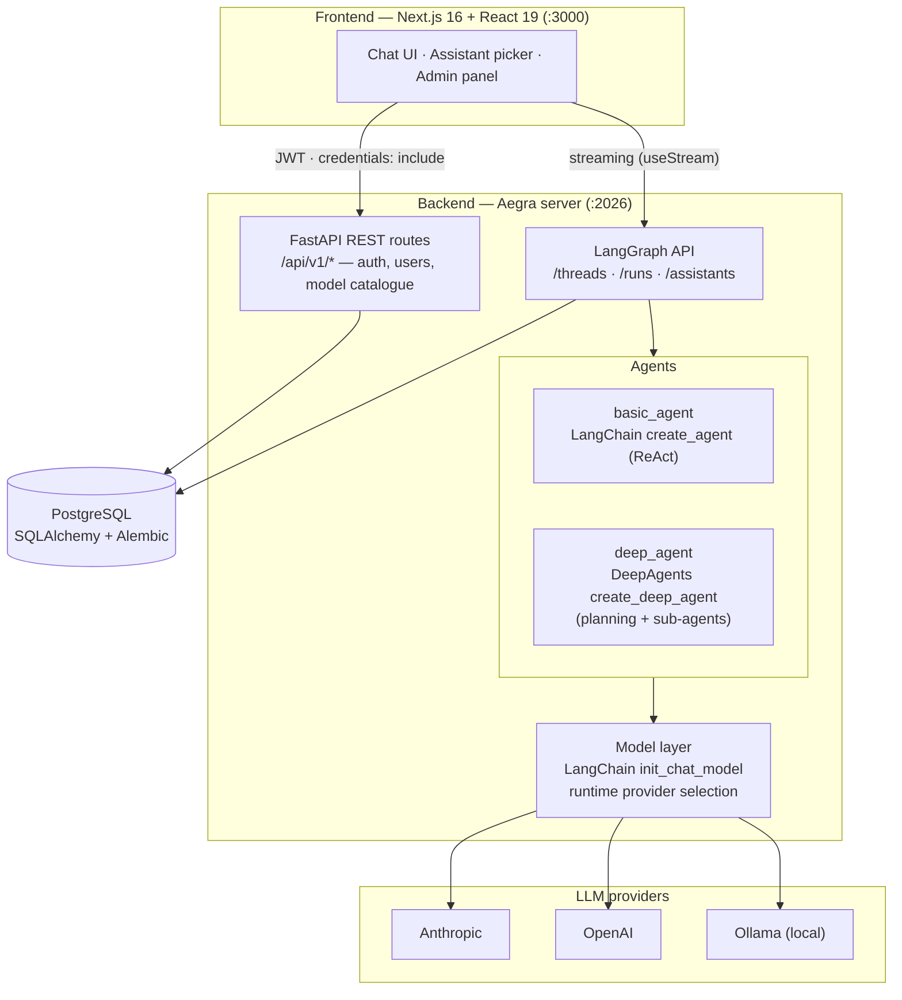
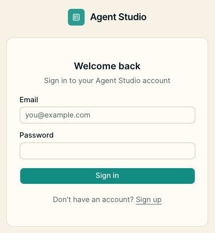
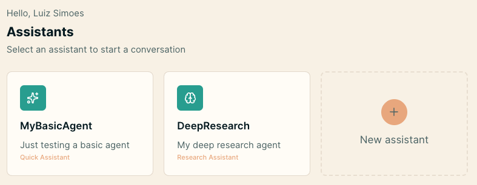
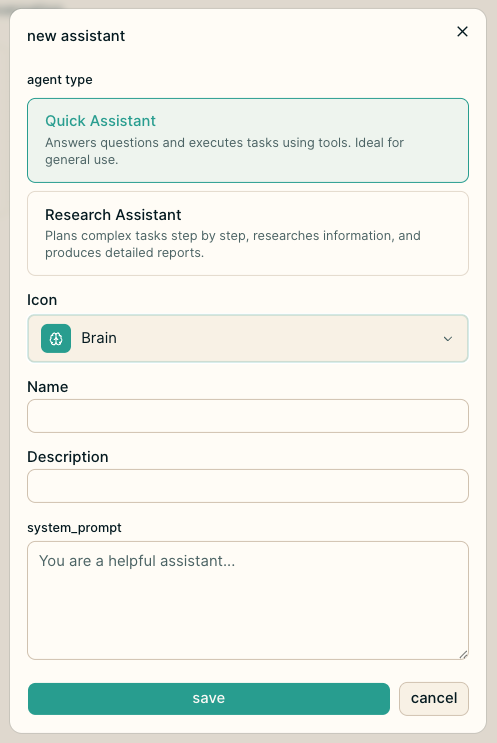
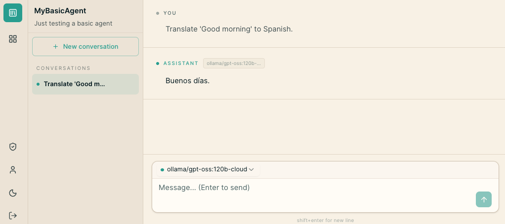
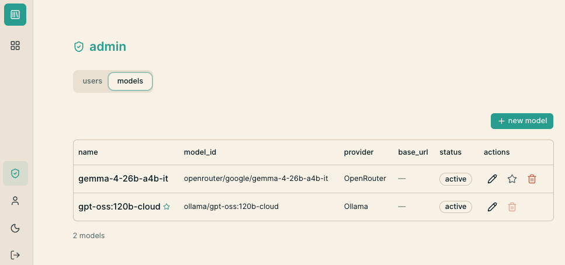

# agents-project-template

A production-ready, full-stack template for building AI agents on top of
**[LangGraph](https://langchain-ai.github.io/langgraph/)**,
**[LangChain](https://python.langchain.com/)**, and
**[DeepAgents](https://github.com/langchain-ai/deepagents)**.

## What this project is

Instead of wiring authentication, persistence, model selection, and a chat UI from
scratch every time you start a new agent, clone this template and get a complete,
opinionated foundation that already works end to end:

- **Two ready-to-use agents.** A `basic_agent` built with LangChain's `create_agent`
  ReAct loop (tools + LLM), and a `deep_agent` built with **DeepAgents'**
  `create_deep_agent` for planning and sub-agent delegation on complex, multi-step
  tasks. Both are exposed through the LangGraph API.
- **Runtime model selection across providers.** Swap the underlying LLM per assistant
  without touching code — Anthropic, OpenAI, or a local Ollama model — through a
  LangChain `init_chat_model` layer driven by configuration.
- **Self-hosted LangGraph runtime.** [Aegra](https://github.com/aegra-dev/aegra)
  serves the standard LangGraph API (threads, runs, assistants) alongside custom
  FastAPI routes on a single port, with full streaming support.
- **Production-grade auth & multi-tenancy.** Dual-layer JWT authentication, refresh
  token rotation with replay detection, rate limiting, and per-user authorization so
  every thread and assistant is scoped to its owner.
- **Batteries-included tooling.** PostgreSQL with Alembic migrations, an LLM model
  catalogue with an admin panel, and a one-command bootstrap wizard.

The goal is simple: go from `git clone` to a running, secure, multi-user agent chat
application in minutes, then focus your effort on the agent logic that makes your
product unique.

### Architecture



## Screenshots

> 📸 Images live in [`assets/screenshots/`](assets/screenshots/). Replace the
> placeholders below with real captures (see that folder's README for the
> suggested file names and sizes).

| Login | Assistant picker |
|-------|------------------|
|  |  |

| Create an assistant | Chat with streaming |
|---------------------|---------------------|
|  |  |

| Admin · model catalogue |
|-------------------------|
|  |

## Prerequisites

- [Docker](https://docs.docker.com/get-docker/) and Docker Compose
- [uv](https://docs.astral.sh/uv/getting-started/installation/)

> The `task` commands below are provided by [taskipy](https://github.com/taskipy/taskipy)
> (tasks defined under `[tool.taskipy.tasks]` in `backend/pyproject.toml`). It is
> installed automatically by `uv sync`, so no separate install is needed — just run
> it through uv as `uv run task <name>`.

---

## Quick start (recommended)

After installing the prerequisites above, clone the repository:

```bash
git clone git@github.com:luizsimoesai/agents-project-template.git
cd agents-project-template
```

Then bootstrap the backend:

```bash
cd backend
uv sync
uv run task bootstrap
```

The interactive wizard generates secrets, starts PostgreSQL, runs migrations,
creates an admin account, and seeds the LLM catalogue. Safe to re-run.

Then start the servers:

```bash
# Terminal 1
uv run task run                           # backend on :2026

# Terminal 2
cd ../frontend && npm install && npm run dev   # frontend on :3000
```

Log in at <http://localhost:3000>.

The manual setup below remains documented for transparency.

---

## Step by step (manual setup)

> Prefer the one-command path? The [Quick start](#quick-start-recommended) above runs
> `task bootstrap`, which does steps 1, 4, and the admin promotion for you. The manual
> flow below is documented for transparency and so you understand each moving part.

### 1. Configure the backend environment

```bash
cd backend
cp .env.example .env
```

Fill in at least these — the server refuses to boot without the first three:

- `JWT_SECRET_KEY` — minimum 32 characters (generate with `openssl rand -hex 32`)
- `POSTGRES_PASSWORD` — any non-empty value (used to provision the local Postgres)
- `ANTHROPIC_API_KEY` and/or `OPENAI_API_KEY` — at least one LLM provider key
- `COOKIE_SECURE=false` — required for the cookie-based auth flow over plain HTTP in dev

### 2. Install dependencies and start the backend

```bash
uv sync             # creates the virtualenv and installs everything
uv run task run     # or: uv run aegra dev
```

`task run` auto-starts PostgreSQL via Docker and applies migrations. The backend is now live:

- API: <http://localhost:2026>
- Swagger docs: <http://localhost:2026/docs>

### 3. Start the frontend

```bash
cd ../frontend
cp .env.example .env.local   # NEXT_PUBLIC_API_URL defaults to http://localhost:2026
npm install
npm run dev                  # http://localhost:3000
```

### 4. Create your account

Open <http://localhost:3000>, go to **Sign up**, and register. (Via API: `POST /api/v1/auth/register`.)

> Registration always creates a regular user (`is_admin=false`) by design. To reach the
> admin panel and manage the model catalogue, promote your user — see
> [Promote a user to admin](#promote-a-user-to-admin).

### 5. Create your first assistant and chat

On the **assistant picker**, choose an agent type (`basic_agent` or `deep_agent`), give it
a name, pick a model from the catalogue, and start chatting.

That's it — you now have a running, secure, multi-user agent chat. 🎉

---

## Promote a user to admin

Promotion is intentionally manual, via SQL, for security. **Skip this** if you used
`task bootstrap` and created the admin through the wizard.

```bash
docker exec -it backend-postgres psql -U backend -d backend \
  -c "UPDATE users SET is_admin = true WHERE email = 'admin@example.com';"
```

---

## Creating an assistant via the API (advanced)

The UI is the easy path. If you'd rather use the raw
[LangGraph API](https://langchain-ai.github.io/langgraph/cloud/reference/api/api_ref/)
that Aegra exposes on the same port, first log in to obtain a token:

```bash
curl -X POST http://localhost:2026/api/v1/auth/login \
  -H "Content-Type: application/json" \
  -d '{"email": "admin@example.com", "password": "password123!"}'
# → { "access_token": "eyJ...", "refresh_token": "eyJ..." }
```

Then create the assistant against one of the registered graphs (`basic_agent` or
`deep_agent` — see `aegra.json`):

```bash
curl -X POST http://localhost:2026/assistants \
  -H "Authorization: Bearer <access_token>" \
  -H "Content-Type: application/json" \
  -d '{
    "graph_id": "basic_agent",
    "name": "My Agent",
    "config": {
      "configurable": {
        "model": "anthropic:claude-sonnet-4-6",
        "system_prompt": "You are a helpful assistant."
      }
    }
  }'
```

Models accept both the `provider/model` and `provider:model` forms, e.g.:
- `"anthropic:claude-sonnet-4-6"`
- `"openai:gpt-4o-mini"`
- `"ollama/llama3:8b"` (requires a local Ollama)

---

## Registering a new agent type

The template uses a two-file convention to expose new graphs to the end user:

**1. Register the graph in the backend** (`backend/aegra.json`):

```json
{
  "graphs": {
    "basic_agent": "./src/agent/basic_agent/graph.py:graph",
    "deep_agent":  "./src/agent/deep_agent/graph.py:graph",
    "my_agent":    "./src/agent/my_agent/graph.py:graph"
  }
}
```

**2. Add the description in the frontend** (`frontend/lib/graph-types.ts`):

```ts
export const GRAPH_TYPES: GraphType[] = [
  // ... existing entries ...
  {
    graph_id: "my_agent",
    label: "Friendly Name",
    description: "A sentence explaining what this agent does.",
  },
]
```

The assistant creation select uses this array — adding an entry here makes the option immediately available to the end user. If an existing assistant has a `graph_id` not listed here, the badge in the list falls back to displaying the raw `graph_id`.

---

## Reset the database

```bash
docker compose down -v        # stop and remove the volume
docker compose up postgres -d # recreate the container
uv run alembic upgrade head   # re-apply migrations
```

---

## Project stack

| Layer     | Technology                                              |
|-----------|---------------------------------------------------------|
| Backend   | FastAPI + Aegra (self-hosted LangGraph API)             |
| Agents    | LangChain `create_agent` · DeepAgents `create_deep_agent` |
| Models    | LangChain `init_chat_model` (Anthropic · OpenAI · Ollama) |
| Database  | PostgreSQL + SQLAlchemy + Alembic                       |
| Auth      | JWT — access + refresh, rotation with replay detection  |
| Frontend  | Next.js 16 + React 19 + Tailwind v4                     |
