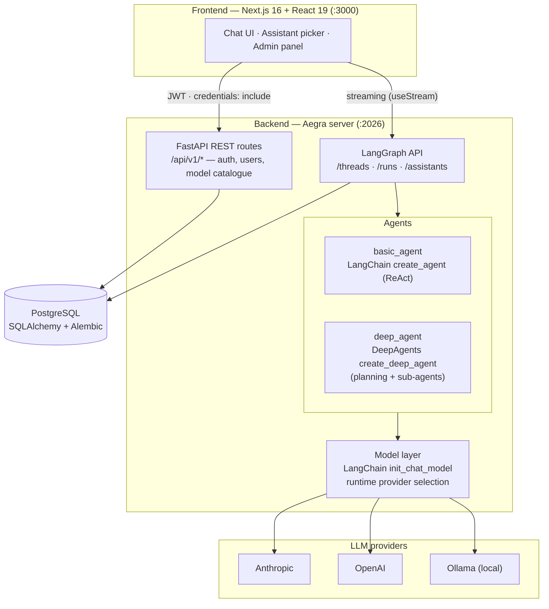

# agents-project-template

A production-ready, full-stack template for building AI agents on top of
**[LangGraph](https://langchain-ai.github.io/langgraph/)**,
**[LangChain](https://python.langchain.com/)**, and
**[DeepAgents](https://github.com/langchain-ai/deepagents)**.

## What this project is

Instead of wiring authentication, persistence, model selection, and a chat UI from
scratch every time you start a new agent, clone this template and get a complete,
opinionated foundation that already works end to end:

- **Two ready-to-use agents.** A `basic_agent` built with LangChain's `create_agent`
  ReAct loop (tools + LLM), and a `deep_agent` built with **DeepAgents'**
  `create_deep_agent` for planning and sub-agent delegation on complex, multi-step
  tasks. Both are exposed through the LangGraph API.
- **Runtime model selection across providers.** Swap the underlying LLM per assistant
  without touching code — Anthropic, OpenAI, or a local Ollama model — through a
  LangChain `init_chat_model` layer driven by configuration.
- **Self-hosted LangGraph runtime.** [Aegra](https://github.com/aegra-dev/aegra)
  serves the standard LangGraph API (threads, runs, assistants) alongside custom
  FastAPI routes on a single port, with full streaming support.
- **Production-grade auth & multi-tenancy.** Dual-layer JWT authentication, refresh
  token rotation with replay detection, rate limiting, and per-user authorization so
  every thread and assistant is scoped to its owner.
- **Batteries-included tooling.** PostgreSQL with Alembic migrations, an LLM model
  catalogue with an admin panel, and a one-command bootstrap wizard.

The goal is simple: go from `git clone` to a running, secure, multi-user agent chat
application in minutes, then focus your effort on the agent logic that makes your
product unique.

### Architecture



## Prerequisites

- [Docker](https://docs.docker.com/get-docker/) and Docker Compose
- [uv](https://docs.astral.sh/uv/getting-started/installation/)

> The `task` commands below are provided by [taskipy](https://github.com/taskipy/taskipy)
> (tasks defined under `[tool.taskipy.tasks]` in `backend/pyproject.toml`). It is
> installed automatically by `uv sync`, so no separate install is needed — just run
> it through uv as `uv run task <name>`.

---

## Quick start (recommended)

After installing the prerequisites above, clone the repository:

```bash
git clone git@github.com:luizsimoesai/agents-project-template.git
cd agents-project-template
```

Then bootstrap the backend:

```bash
cd backend
uv sync
uv run task bootstrap
```

The interactive wizard generates secrets, starts PostgreSQL, runs migrations,
creates an admin account, and seeds the LLM catalogue. Safe to re-run.

Then start the servers:

```bash
# Terminal 1
uv run task run                           # backend on :2026

# Terminal 2
cd ../frontend && npm install && npm run dev   # frontend on :3000
```

Log in at <http://localhost:3000>.

The manual setup below remains documented for transparency.

---

## Step by step: from clone to first agent

### 1. Set up the environment

```bash
cd backend
cp .env.example .env
```

Edit the `.env` and fill in at least:

- `JWT_SECRET_KEY` — minimum 32 characters (generate with `openssl rand -hex 32`)
- `OPENAI_API_KEY` or `ANTHROPIC_API_KEY` — LLM provider key

### 2. Install dependencies

```bash
cd backend

uv venv
uv sync

uv run aegra dev # or uv run task run
```


```bash
# Server: http://localhost:2026
# Docs (Swagger): http://localhost:2026/docs
```

---

## Creating the first admin user

The `POST /api/v1/auth/register` endpoint is public but always creates regular users (`is_admin=false`). Admin promotion is done via SQL — this is intentional for security reasons.

### Register the user

```bash
curl -X POST http://localhost:2026/api/v1/auth/register \
  -H "Content-Type: application/json" \
  -d '{"name": "Admin", "email": "admin@example.com", "password": "password123!"}'
```

Or use the interface at `http://localhost:2026/docs` → `POST /api/v1/auth/register`.

### Promote to admin via SQL

```bash
docker exec -it backend-postgres psql -U backend -d backend \
  -c "UPDATE users SET is_admin = true WHERE email = 'admin@example.com';"
```

### Log in and obtain the JWT

```bash
curl -X POST http://localhost:2026/api/v1/auth/login \
  -H "Content-Type: application/json" \
  -d '{"email": "admin@example.com", "password": "password123!"}'
```

Response:

```json
{
  "access_token": "eyJ...",
  "refresh_token": "eyJ..."
}
```

---

## Creating a new assistant (agent)

Aegra exposes the [LangGraph API](https://langchain-ai.github.io/langgraph/cloud/reference/api/api_ref/) on the same port. The `agent` graph is registered in `aegra.json`.

```bash
curl -X POST http://localhost:2026/assistants \
  -H "Authorization: Bearer <access_token>" \
  -H "Content-Type: application/json" \
  -d '{
    "graph_id": "agent",
    "name": "My Agent",
    "config": {
      "configurable": {
        "model": "anthropic/claude-sonnet-4-6",
        "system_prompt": "You are a helpful assistant."
      }
    }
  }'
```

Available models follow the `"provider/model"` format, e.g.:
- `"anthropic/claude-sonnet-4-6"`
- `"openai/gpt-4o-mini"`
- `"ollama/llama3.2"` (requires local Ollama)

---

## Registering a new agent type

The template uses a two-file convention to expose new graphs to the end user:

**1. Register the graph in the backend** (`backend/aegra.json`):

```json
{
  "graphs": {
    "agent":      "./src/agent/graph.py:graph",
    "deep_agent": "./src/agent/deepagents/graph.py:graph",
    "my_agent":   "./src/agent/my_agent/graph.py:graph"
  }
}
```

**2. Add the description in the frontend** (`frontend/lib/graph-types.ts`):

```ts
export const GRAPH_TYPES: GraphType[] = [
  // ... existing entries ...
  {
    graph_id: "my_agent",
    label: "Friendly Name",
    description: "A sentence explaining what this agent does.",
  },
]
```

The assistant creation select uses this array — adding an entry here makes the option immediately available to the end user. If an existing assistant has a `graph_id` not listed here, the badge in the list falls back to displaying the raw `graph_id`.

---

## Reset the database

```bash
docker compose down -v        # stop and remove the volume
docker compose up postgres -d # recreate the container
uv run alembic upgrade head   # re-apply migrations
```

---

## Project stack

| Layer     | Technology                        |
|-----------|-----------------------------------|
| Backend   | FastAPI + Aegra + LangGraph       |
| Agent     | LangGraph ReAct (tools + LLM)     |
| Database  | PostgreSQL + SQLAlchemy + Alembic |
| Auth      | JWT (access + refresh tokens)     |
| Frontend  | Next.js                           |
