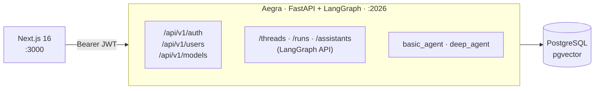

# Onboarding & Template Launch — Design Spec

**Date:** 2026-05-23
**Status:** Draft
**Owner:** Luiz Simoes

## Overview

This spec covers a coordinated initiative to make `agents-project-template` ready for official publication: a friendly first-run experience, sane configuration defaults, professional public documentation, and automated quality signal via CI.

Today, taking a fresh clone to a working chat requires ~15 minutes of manual steps documented in the README: generate a JWT secret with `openssl`, edit `.env` by hand, run `docker compose up postgres`, run migrations, `curl POST /auth/register`, `docker exec` into Postgres to `UPDATE users SET is_admin=true`, `curl POST /auth/login`, and finally `curl POST /models` for every LLM model the catalog needs. The template also lacks a LICENSE, a polished README, and CI — all expected for a publicly-promoted OSS template.

After this initiative, the same path becomes:

```bash
git clone <repo> && cd <repo>/backend
uv sync
task bootstrap          # interactive wizard, ~2 minutes
task run
# in another terminal
cd ../frontend && npm install && npm run dev
```

…with a professional README, an MIT LICENSE, a green CI badge, and clear empty states that guide the admin when the catalog is unconfigured.

### Why this design

- **Default credentials are a known attack surface.** Templates that ship with `admin/admin` accounts (Jenkins, Mongo, Elasticsearch defaults) end up on the public internet unchanged. The wizard prompts for credentials and never hardcodes any.
- **Sane defaults beat documentation.** The current `.env.example` ships placeholders (`OPENAI_API_KEY=sk-...`) that look valid until the first chat fails — a classic onboarding cliff. Comment them out and let the wizard fill them.
- **One CLI command is a discoverable entry point.** Taskipy already drives `task lint`, `task test`, `task format`; adding `task bootstrap` is consistent and trivially discoverable via `task --list`.
- **Empty states are part of onboarding.** Even after the CLI runs, a user landing on a page with no models in the catalog must be told *why* and *what to do*. Silently rendering `null` (current behaviour) is hostile.

### Scope decomposition

Four parallel fronts, organised as one umbrella spec with a phased implementation plan to keep PRs reviewable:

| Front | Topic | Phase |
|---|---|---|
| **A** | Bootstrap CLI (`task bootstrap`) | 1 |
| **B** | Sane defaults in `.env.example` and `docker-compose.yml` | 1 |
| **C** | README rewrite, LICENSE, GitHub Actions CI | 2 |
| **D** | Empty states in the frontend | 3 |

Phase 1 ships the user-visible improvement. Phase 2 prepares the launch. Phase 3 polishes the surface area exposed by Phase 1.

### Cross-cutting principles

1. **Secure by default.** No hardcoded credentials. JWT secret is always generated or validated.
2. **Idempotent.** Re-running `task bootstrap` on a configured project is safe and silent.
3. **No hidden magic.** Each wizard step announces what it will do before doing it.
4. **English only.** All new code comments, log messages, prompts, error strings, and documentation are in English. Personal notes (`NOTES.md`) remain local and gitignored.
5. **YAGNI.** No duplicated setup wizard in the frontend, no `task reset` (data-destructive), no API-key format validation.

---

## Front A — Bootstrap CLI (`task bootstrap`)

### A.1 File layout

```
backend/
├── src/
│   └── cli/                    # new module
│       ├── __init__.py
│       └── bootstrap.py        # single entry point (~250 lines)
├── seeds/
│   └── models.yaml             # curated LLM model catalog
└── pyproject.toml              # +2 deps, +1 task
```

Kept in a single file for the first iteration — the wizard is linear, with no complex branching. Split if it grows past ~400 lines.

### A.2 New dependencies

| Dep | Purpose |
|---|---|
| `rich>=14.0.0` | Hidden password prompts, panels, coloured output. Small footprint. |
| `pyyaml>=6.0` | Parse `seeds/models.yaml`. The standard library has no YAML support. |

`argparse` from the standard library covers the three CLI flags; adding `typer` for this is overkill.

### A.3 Wizard flow (eight steps)

```
$ task bootstrap

╭───────────────────────────────────────────────────────────╮
│  agents-project-template · Bootstrap                      │
│  This wizard sets up your project from zero to running.   │
│  Safe to re-run: each step checks current state.          │
╰───────────────────────────────────────────────────────────╯

[1/8] .env file
      ✓ .env already exists (skipping copy from .env.example)

[2/8] JWT secret
      ⟳ JWT_SECRET_KEY is empty. Generating one...
      ✓ Wrote 64-char secret to .env

[3/8] Database password
      ? POSTGRES_PASSWORD is empty. Enter a password: ********
      ✓ Saved to .env

[4/8] LLM provider keys
      ? Do you have an Anthropic API key? [y/N]: y
      ? Paste your Anthropic key: ***************************
      ✓ Saved ANTHROPIC_API_KEY
      ? Do you have an OpenAI API key? [y/N]: n
      ? Do you have an OpenRouter API key? [y/N]: n

[5/8] PostgreSQL container
      ⟳ Starting postgres via docker compose...
      ⟳ Waiting for healthcheck... (3s)
      ✓ Postgres is healthy on :5432

[6/8] Database migrations
      ⟳ Running alembic upgrade head...
      ✓ Schema up to date (4 migrations applied)

[7/8] Admin user
      ? Admin email: admin@example.com
      ? Admin password (min 8 chars): ********
      ? Confirm password: ********
      ✓ Created admin (id=a1b2…, is_admin=true)

[8/8] Seed LLM models
      ⟳ Reading seeds/models.yaml...
      ⟳ Filtering by configured providers (anthropic, ollama)...
      ✓ Inserted 3 models · default: anthropic:claude-sonnet-4-6

╭───────────────────────────────────────────────────────────╮
│  ✓ Bootstrap complete                                     │
│                                                           │
│  Next steps:                                              │
│    backend:   task run                                    │
│    frontend:  cd ../frontend && npm install && npm run dev│
│                                                           │
│  Login at http://localhost:3000                           │
│  API docs at http://localhost:2026/docs                   │
╰───────────────────────────────────────────────────────────╯
```

### A.4 Idempotency contract

Every step checks state first and skips when already complete:

| Step | Skip condition |
|---|---|
| 1 — `.env` | File exists |
| 2 — JWT secret | Value non-empty AND ≥32 chars AND not placeholder |
| 3 — DB password | Value non-empty AND not placeholder |
| 4 — LLM keys | Per-provider: key non-empty AND not placeholder (`sk-...`, `pk-...`) |
| 5 — Postgres | `docker ps` shows the container healthy |
| 6 — Migrations | `alembic current` matches `alembic heads` |
| 7 — Admin | `SELECT count(*) FROM users WHERE is_admin=true` > 0 |
| 8 — Models | Per YAML entry: `model_id` already exists in `llm_models` |

Result: re-running `task bootstrap` on a configured project performs eight quick checks, prints `✓ skipping (already configured)` for each, and exits in roughly two seconds.

### A.5 Non-interactive mode

For CI, Docker, or scripted provisioning:

```bash
task bootstrap -- --non-interactive
```

Reads values from environment variables when prompts would otherwise occur:

| Env var | Used by step | Required when |
|---|---|---|
| `BOOTSTRAP_ADMIN_EMAIL` | 7 | No admin exists yet |
| `BOOTSTRAP_ADMIN_PASSWORD` | 7 | No admin exists yet |
| `POSTGRES_PASSWORD` | 3 | `.env` lacks one |
| `ANTHROPIC_API_KEY`, `OPENAI_API_KEY`, `OPENROUTER_API_KEY` | 4 | At least one must be set (otherwise the seed step has nothing to seed besides Ollama) |

`JWT_SECRET_KEY` is auto-generated silently in non-interactive mode if missing.

Missing required input aborts with `exit 1` and a clear error indicating which variable to set. No prompts are shown.

### A.6 Error handling

| Scenario | Behaviour |
|---|---|
| Docker daemon unreachable | `Error: Docker daemon not reachable. Start Docker Desktop and re-run.` Exit 1. |
| Postgres healthcheck times out (60 s) | `Error: Postgres did not become healthy in 60s. Check 'docker compose logs postgres'.` Exit 1. |
| Admin password fails validation (< 8 chars) | Interactive: re-prompt. Non-interactive: abort with hint. |
| Admin email already exists | Interactive: ask `Use existing admin instead? [Y/n]`. Non-interactive: abort. |
| `docker pull` network failure | Clear error with the underlying `docker compose` output; user retries when network is back. |
| Alembic failure | Re-raise with hint about possible inconsistent state. Idempotency makes rerun safe. |

There is no cross-step transactional rollback — idempotency covers the "ran half, errored" case: just re-run.

### A.7 Seed catalog (`backend/seeds/models.yaml`)

Curated catalog. Adding a model means editing this file; no Python change. The wizard inserts only entries whose `provider` has a configured API key (Ollama is always included — no key required).

```yaml
# Curated LLM catalog used by `task bootstrap`.
# Wizard inserts entries whose `provider` matches a configured API key.
# `is_default: true` is allowed on at most one entry (validated at load time).
# If the default-marked entry's provider is unavailable, the wizard promotes
# the first surviving entry to default and prints a warning.

models:
  - display_name: "Claude Sonnet 4.6"
    model_id: "anthropic:claude-sonnet-4-6"
    provider: "anthropic"
    description: "Anthropic's flagship balanced reasoning model"
    is_default: true

  - display_name: "Claude Haiku 4.5"
    model_id: "anthropic:claude-haiku-4-5"
    provider: "anthropic"
    description: "Faster, cheaper Claude for high-volume workloads"

  - display_name: "GPT-4o"
    model_id: "openai:gpt-4o"
    provider: "openai"
    description: "OpenAI's flagship multimodal model"

  - display_name: "GPT-4o mini"
    model_id: "openai:gpt-4o-mini"
    provider: "openai"
    description: "Affordable, fast OpenAI option"

  - display_name: "Llama 3.2 (local)"
    model_id: "ollama:llama3.2"
    provider: "ollama"
    description: "Local Llama via Ollama — no API key required"
```

### A.8 `pyproject.toml` delta

```toml
dependencies = [
    # ...existing entries...
    "rich>=14.0.0",
    "pyyaml>=6.0",
]

[tool.taskipy.tasks]
# ...existing entries...
bootstrap = 'uv run python -m src.cli.bootstrap'
```

---

## Front B — Sane defaults in `.env.example` and `docker-compose.yml`

Small front: three file edits, no new logic. Goal: remove known booby-traps.

### B.1 `backend/.env.example`

```diff
- AUTH_TYPE=noop  # noop, custom
+ # Aegra auth mode. `custom` enables this template's JWT handler.
+ # `noop` disables authentication entirely — do NOT use except in isolated dev.
+ AUTH_TYPE=custom

- MODEL=ollama/gpt-oss:120b-cloud
+ # Default model used when an assistant does not specify one.
+ # Format: provider:model (e.g. anthropic:claude-sonnet-4-6, openai:gpt-4o-mini).
+ # Leave empty so `task bootstrap` selects one based on configured providers.
+ MODEL=

  # --- LLM Providers ---
- OPENAI_API_KEY=sk-...
- # ANTHROPIC_API_KEY=...
- # TOGETHER_API_KEY=...
- # OPENROUTER_API_KEY=...
+ # Configure AT LEAST ONE. `task bootstrap` prompts and writes the values here.
+ # All are commented out by default so the wizard does not mistake placeholders
+ # for real keys. (TOGETHER_API_KEY is removed; no Together models are in the
+ # seed catalogue. Re-add it manually if you extend seeds/models.yaml.)
+ # OPENAI_API_KEY=
+ # ANTHROPIC_API_KEY=
+ # OPENROUTER_API_KEY=

  # [Target: Langfuse]
  LANGFUSE_BASE_URL=https://cloud.langfuse.com
- LANGFUSE_PUBLIC_KEY=pk-...
- LANGFUSE_SECRET_KEY=sk-...
+ # LANGFUSE_PUBLIC_KEY=
+ # LANGFUSE_SECRET_KEY=
```

Rationale:

| Change | Why |
|---|---|
| `AUTH_TYPE=custom` | The template assumes JWT throughout. `noop` is a silent booby-trap: any authenticated user becomes effectively unauthenticated in Aegra. |
| `MODEL=` empty | The previous default required infrastructure nobody has. Empty + wizard-driven selection eliminates the surprise. |
| API keys commented out | A commented line cannot become a false positive in the wizard's skip-check. The literal `sk-...` was worse: it looked configured but failed at first chat. |

Existing Portuguese comments in `.env.example` (currently mixed with English) are rewritten in English during this pass.

### B.2 `backend/docker-compose.yml`

```diff
       POSTGRES_USER: ${POSTGRES_USER:-backend}
-      POSTGRES_PASSWORD: ${POSTGRES_PASSWORD:-backend_secret}
+      POSTGRES_PASSWORD: ${POSTGRES_PASSWORD:?POSTGRES_PASSWORD is required (set in .env via task bootstrap)}
       POSTGRES_DB: ${POSTGRES_DB:-backend}
```

(Both occurrences: the `postgres` service and the `backend` service `environment` block.)

The previous default `backend_secret` contradicted `settings.py`, which refuses to start without `POSTGRES_PASSWORD`. The `:?` syntax aborts `docker compose` with a clear message when the variable is unset, fixing the contradiction.

### B.3 `tests/test_env_example_safety.py` (new, ~30 lines)

A small regression test that asserts `.env.example` contains no uncommented placeholder API keys (substrings like `sk-...`, `pk-...`, `your-key-here`) on lines that would be picked up as real values. Catches the anti-pattern if it ever creeps back in.

### B.4 Not in scope

No new validators in `src/core/settings.py`. API keys do not flow through `Settings` — LangChain reads them directly via `os.environ`. Detecting "fake key" by regex is fragile (Anthropic key formats changed twice in two years). The wizard fixes the root cause by commenting the lines out.

---

## Front C — README, LICENSE, CI

### C.1 `README.md` (full rewrite in English)

Target length ~250 lines. Structure:

```
# agents-project-template

[BADGES: CI passing · License MIT · Python 3.12+ · Next.js 16 · PRs welcome]

> Production-ready full-stack template for LangGraph agents.
> FastAPI + Aegra backend · Next.js 16 frontend · JWT auth · multi-LLM.

[SCREENSHOT/GIF: chat UI · 800px wide] <!-- SCREENSHOT TBD -->

## What you get
  · Multi-provider LLM (Anthropic, OpenAI, OpenRouter, Ollama) — runtime switching
  · JWT auth with refresh-token rotation + replay detection
  · Admin panel + per-user thread isolation
  · PostgreSQL + Alembic + Docker Compose
  · End-to-end type safety (mypy strict + TS strict)
  · Two agent flavours out of the box: ReAct + Deep Agent

## Prerequisites
## Quick start (≈ 2 min)
## Architecture
## Adding a new agent
## Adding a new LLM model
## Development tasks
## Configuration reference
## Project layout
## Deployment notes
## Contributing → CONTRIBUTING.md
## License → MIT
## Acknowledgements
```

#### Prerequisites section (required content)

```markdown
## Prerequisites

Tested on **macOS** and **Linux**. On **Windows**, use **WSL2** (the wizard
calls `docker compose`, `openssl`-style randomness, and Unix-style password
prompts that misbehave under native Windows shells).

Install before running the bootstrap wizard:

| Tool | Minimum version | Why |
|---|---|---|
| [Docker Engine](https://docs.docker.com/engine/install/) + Compose plugin v2+ | 24.0 / Compose 2.20 | Runs PostgreSQL locally |
| [uv](https://docs.astral.sh/uv/getting-started/installation/) | 0.10 | Python package and project manager |
| [Node.js](https://nodejs.org/) (LTS) | 20.x | Frontend toolchain (Next.js 16) |
| [Git](https://git-scm.com/downloads) | any recent | Clone the template |

You also need **at least one LLM provider API key**:
[Anthropic](https://console.anthropic.com/), [OpenAI](https://platform.openai.com/api-keys),
[OpenRouter](https://openrouter.ai/keys), or
[Ollama](https://ollama.ai/) running locally (no key required).

No need to install `task` as a separate tool — it ships with the Python deps
and is invoked through `uv run task <name>` (or directly `task <name>` once
the venv is active).
```

#### Architecture section

Mermaid diagram (renders natively on GitHub, kept in version control):

````markdown
## Architecture


````

The rest of the README replaces the existing structure section-for-section. Code blocks use English-only comments. Trilingual residue from the current README is removed.

### C.2 `LICENSE` (new, MIT)

Standard MIT text with `Copyright (c) 2026 Luiz Simoes`.

### C.3 `CONTRIBUTING.md` (new, ~80 lines)

Contents:
- Link back to the README Quick start
- Commit-message convention matching current history (`feat(scope):`, `fix(scope):`, `refactor(scope):`, `docs:`, `test:`, `chore:`)
- Branching: feature branches off `main`, PR back to `main`, no force-push to `main`
- Required checks before opening a PR: `task lint && task test` in backend, `npm run test:run && npm run build` in frontend
- Migration etiquette: always run `uv run alembic heads` before authoring a new revision and set `down_revision` to that hash
- Adding a new agent (link to the README section)
- When to ask before implementing (schema changes, new dependencies, significant refactors)

### C.4 GitHub templates (new)

Path | Purpose
---|---
`.github/PULL_REQUEST_TEMPLATE.md` | Short checklist: tests? migration? docs updated?
`.github/ISSUE_TEMPLATE/bug_report.md` | Reproduction steps, expected, actual, environment
`.github/ISSUE_TEMPLATE/feature_request.md` | Problem statement, proposed solution, alternatives

### C.5 `.github/workflows/ci.yml` (new)

Two jobs in parallel, both running on PRs and pushes to `main`:

```yaml
name: CI
on:
  pull_request:
  push:
    branches: [main]

jobs:
  backend:
    runs-on: ubuntu-latest
    services:
      postgres:
        image: pgvector/pgvector:pg18
        env:
          POSTGRES_USER: backend
          POSTGRES_PASSWORD: ci_secret
          POSTGRES_DB: backend
        ports: ['5432:5432']
        options: >-
          --health-cmd pg_isready --health-interval 5s
          --health-timeout 5s --health-retries 10
    env:
      POSTGRES_PASSWORD: ci_secret
      JWT_SECRET_KEY: "0000000000000000000000000000000000000000000000000000000000000000"
      RATE_LIMIT_ENABLED: "false"
    defaults:
      run:
        working-directory: backend
    steps:
      - uses: actions/checkout@v4
      - uses: astral-sh/setup-uv@v4
        with:
          python-version: '3.12'
      - run: uv sync
      - run: uv run alembic upgrade head
      - run: uv run task lint
      - run: uv run task test

  frontend:
    runs-on: ubuntu-latest
    defaults:
      run:
        working-directory: frontend
    steps:
      - uses: actions/checkout@v4
      - uses: actions/setup-node@v4
        with:
          node-version: '20'
          cache: npm
          cache-dependency-path: frontend/package-lock.json
      - run: npm ci
      - run: npm run test:run
      - run: npm run build
```

CI badge added to the top of the README.

### C.6 `docs/release-checklist.md` (new, ~30 lines)

Manual steps to perform on the GitHub repo after Phase 2 merges:

- Set repository **description**: "Production-ready full-stack template for LangGraph agents. FastAPI + Next.js 16 + JWT auth + multi-LLM."
- Add **topics**: `langgraph`, `fastapi`, `nextjs`, `agent-template`, `jwt-auth`, `aegra`
- Settings → General → **Template repository** checkbox (enables "Use this template")
- (Optional) Social preview image 1280×640 px

These are not codifiable in the repo itself, but the checklist file ensures they are not forgotten.

---

## Front D — Empty states in the frontend

Three surfaces today render unhelpfully when the LLM catalog is empty. Fix two, leave one.

### D.1 New shared component `frontend/components/ui/EmptyState.tsx`

```tsx
interface EmptyStateProps {
  icon?: ReactNode
  title: string
  description: ReactNode  // ReactNode so descriptions can include links
  action?: ReactNode      // optional CTA button
}
```

Reused by the two fixes below for consistent visuals.

### D.2 `app/(app)/(chat)/assistants/[id]/threads/page.tsx`

Today: `<ModelPicker>` returns `null` when the catalog is empty (`ModelPicker.tsx:23`). The thread-creation form renders without a picker; users do not understand what is missing.

Change: above the form, when `models.length === 0`, render an `EmptyState`:

```
┌────────────────────────────────────────────────────────────┐
│  ⚠  No LLM models configured                               │
│                                                            │
│  This template needs at least one model in the catalog     │
│  to start a conversation.                                  │
│                                                            │
│  [If user is admin]                                        │
│    → Go to Admin · Models   (link to /admin/models)        │
│                                                            │
│  [If user is not admin]                                    │
│    Ask an administrator to configure one, or have them     │
│    run `task bootstrap` on the backend.                    │
└────────────────────────────────────────────────────────────┘
```

The "Create thread" button is `disabled` with tooltip "Configure a model first" until a model exists.

### D.3 `components/admin/AdminModelTable.tsx`

Today: the table renders empty rows. Admin sees headers and nothing else.

Change: empty-state row inside the table body:

```
┌────────────────────────────────────────────────────────────┐
│  No models in the catalog yet                              │
│                                                            │
│  Add models manually with [+ Add model] above,             │
│  or run `task bootstrap` in the backend to seed the        │
│  curated catalog (filtered by your configured providers).  │
└────────────────────────────────────────────────────────────┘
```

The `[+ Add model]` action stays enabled (this is the recovery path).

### D.4 `components/chat/ChatInput.tsx` — no change

Mid-conversation picker keeps its current `return null` behaviour when the catalog is empty. A thread mid-flight already has its `model_id` stored in metadata; the rare case of "admin deleted the last model during a live conversation" does not warrant special UI. Revisit only if it becomes a real complaint.

### D.5 Detecting admin in the frontend

`useAuth()` already exposes `user.is_admin` (Zustand store + `/auth/me`). Empty-state components receive it as a prop or consult the store directly. No new API surface.

---

## Testing strategy

### Front A

| Test file | Coverage |
|---|---|
| `tests/cli/test_env_file.py` | In-place `.env` mutation: add missing keys, update existing keys, preserve comments and ordering, create the file from scratch |
| `tests/cli/test_seed_loader.py` | `models.yaml` parsing, schema validation (at most one `is_default`), provider filtering, automatic default promotion when the originally-defaulted provider is unavailable |
| `tests/cli/test_idempotency.py` | Each `check_skip_*()` returns the right boolean given current `.env` and DB state (DB mocked with `AsyncMock(spec=AsyncSession)`) |
| `tests/cli/test_bootstrap_flow.py` | Smoke end-to-end with `subprocess.run` mocked (Docker, Alembic). Runs the wizard twice; the second run performs zero writes |
| `tests/cli/test_bootstrap_non_interactive.py` | `--non-interactive` flag: accepts env vars, aborts with clear messages when required inputs are missing, `exit 1` on abort |

Out of scope for tests:
- Real Docker bring-up (mocked)
- `rich` interactive prompts (use `monkeypatch` on `Prompt.ask` / `Confirm.ask`)
- Colour and formatting of output

Anti-pattern to avoid: spawning the module via `subprocess` in tests — slow and flaky. Import the functions and call them directly.

### Front B

No new tests beyond `tests/test_env_example_safety.py` (the regression guard described in B.3). Coverage is implicit: the wizard tested in Front A consumes the new `.env.example`, and CI runs `task test` with a CI-specific `.env`.

### Front C

The CI itself is the test. Definition of done: a PR shows ✓ green on Actions and the README badge resolves correctly.

Not in scope: external link checking (`lychee`-style). Add later if link rot becomes a complaint.

### Front D

| Test file | Coverage |
|---|---|
| `components/ui/EmptyState.test.tsx` | Renders title, description, and action; description accepts `ReactNode` (including anchor elements) |
| `app/(app)/(chat)/assistants/[id]/threads/page.test.tsx` | `models = []` → empty state visible, "Create thread" disabled; admin sees the `/admin/models` link, non-admin sees the textual instruction |
| `components/admin/AdminModelTable.test.tsx` (extends existing) | `models = []` → empty state references `task bootstrap`; `[+ Add model]` remains enabled |

Mock pattern: `vi.mock("@/lib/hooks/useModels")` returning `{ data: [], isLoading: false }`, matching the project's existing convention.

### Aggregate targets

| Metric | Target |
|---|---|
| Backend coverage (`pytest --cov`) | ≥ 85 % (current baseline) — must not regress |
| Frontend coverage | No gate today; unchanged for v1 |
| Total CI wall time (backend + frontend in parallel) | ≤ 4 min |

---

## Phased implementation plan

### Phase 1 — "It just works" (Fronts B + A)

Order within the phase: B first (three trivial edits, no logic), then A (the CLI).

| Step | File | Effort |
|---|---|---|
| B.1 | `backend/.env.example` | XS |
| B.2 | `backend/docker-compose.yml` | XS |
| B.3 | `tests/test_env_example_safety.py` | XS |
| A.1 | `backend/seeds/models.yaml` | S |
| A.2 | `backend/src/cli/__init__.py` + `bootstrap.py` | M |
| A.3 | `pyproject.toml` (deps + task) | XS |
| A.4 | Tests per §Testing/Front A | M |
| A.5 | `README.md` — minimal pointer to `task bootstrap` (full rewrite happens in Phase 2) | XS |

**Definition of done:** Fresh `git clone` followed by `uv sync` and `task bootstrap` yields a running backend with admin and seeded models; everything passes locally with `task lint && task test`.

**Approximate size:** one day of focused work; ~500–700 lines (~300 code + ~400 tests/config).

### Phase 2 — "It looks official" (Front C)

| Step | File | Effort |
|---|---|---|
| C.1 | `LICENSE` (MIT, Luiz Simoes) | XS |
| C.2 | `README.md` — full English rewrite per §C.1 | M |
| C.3 | `CONTRIBUTING.md` | S |
| C.4 | `.github/PULL_REQUEST_TEMPLATE.md` + two issue templates | XS |
| C.5 | `.github/workflows/ci.yml` | S |
| C.6 | `docs/release-checklist.md` | XS |

**Definition of done:** Push to `main` triggers CI; the README badge resolves green; GitHub detects the LICENSE; the "Template repository" toggle is enabled (manual, per the release checklist).

**Approximate size:** half to one day; ~400 lines (mostly prose).

**Depends on Phase 1:** the README references `task bootstrap`; the CI runs `task test`, which requires Phase 1 to be stable.

### Phase 3 — "It guides the user" (Front D)

| Step | File | Effort |
|---|---|---|
| D.1 | `frontend/components/ui/EmptyState.tsx` + test | S |
| D.2 | `app/(app)/(chat)/assistants/[id]/threads/page.tsx` — empty state + disabled form | S |
| D.3 | `components/admin/AdminModelTable.tsx` — empty-state row | XS |
| D.4 | Tests per §Testing/Front D | S |

**Definition of done:** With `llm_models` empty, the frontend gives clear, role-aware guidance instead of rendering blank chrome.

**Approximate size:** half a day; ~200 lines.

**Depends on Phase 1:** the empty-state copy references `task bootstrap`.

---

## Risks

| Risk | Mitigation |
|---|---|
| Native Windows bootstrap fails (Docker quirks, no `openssl`, `rich` hidden prompts misbehave under PowerShell) | README "Prerequisites" states macOS / Linux / WSL2 only. Windows native is out of scope. |
| Upstream `aegra-cli` major bump changes `aegra dev` | Already pinned in `pyproject.toml` (`aegra-cli>=0.9.2`). Re-validate at each major bump. |
| Models in `seeds/models.yaml` go stale (deprecated names) | YAML is trivially PR-able. No automatic catalogue refresh in v1. |
| GitHub Actions Postgres service consumes paid minutes | Acceptable: ~2 min per run, well within the free tier for public repositories. |
| First-run is slow on bad networks (`docker pull` for the Postgres image) | The wizard prints "This can take 1–3 min on first run." before step 5. |
| Wizard writes `.env` but Postgres fails before migrations apply, leaving partial state | Idempotency makes rerun safe. Documented in the wizard's `--help` text. |

---

## Non-goals (explicitly out of scope for this initiative)

- End-to-end tests with Playwright or Cypress
- A duplicate setup wizard in the frontend (the CLI is the source of truth)
- Sniffing the shell environment for LLM keys outside `.env`
- API-key format validation in `settings.py` (false positives are worse than silence)
- `CODE_OF_CONDUCT.md` (add when a community materialises)
- Frontend internationalisation
- Cloud deployment automation (Terraform / Pulumi)
- Helm charts or Kubernetes manifests
- Multi-database support beyond PostgreSQL
- Secret-manager integration (Vault, AWS Secrets Manager, etc.)
- A destructive `task reset` command (users invoke `docker compose down -v` manually if needed)

---

## Open items

1. **Screenshot in the README.** Spec marks `<!-- SCREENSHOT TBD -->`; the user generates it at convenience post-launch. Does not block any phase.

No other open items: copyright holder is Luiz Simoes; English is the official documentation language; the prerequisites section is included in the README per §C.1.
